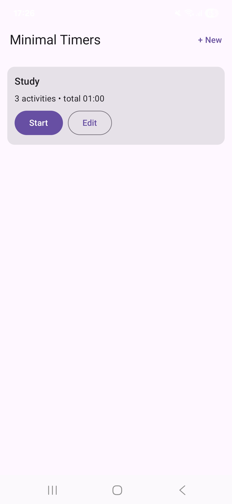
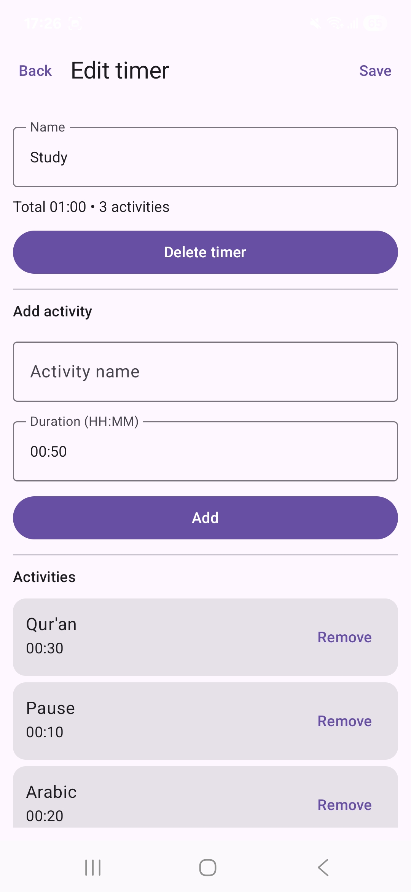
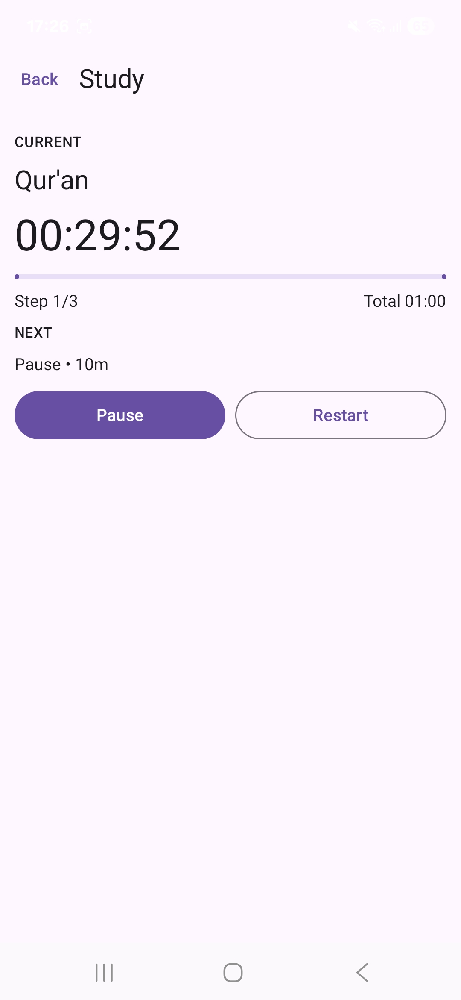

# ⏱️ Minimal Timers

A clean, distraction-free Android app for creating **multi-step timers** for focused activities.

---

## 📥 Download APK

👉 **[Download latest APK](https://github.com/amarhusika/minimaltimers/releases/latest/download/minimal_timers.apk)**

> Minimum Android version: Android 8.0 (API 26)  

---

## ✨ Features

- ⏳ Create timers made of multiple activities
- 🔔 Beep sound at the end of each activity and at timer completion
- 🧘 Pause / Resume during a session
- 🔁 Restart the current session at any time
- 📝 Edit timer name, activities and durations
- 🎨 Minimal, calm UI focused on productivity
- 🚫 No ads, no tracking
- 🔐 Works fully offline

---

## 📱 Screenshots

  
  
  

---

## 🛠️ Built With

- **Kotlin**
- **Jetpack Compose**
- **Material 3**
- **Gradle**

---

